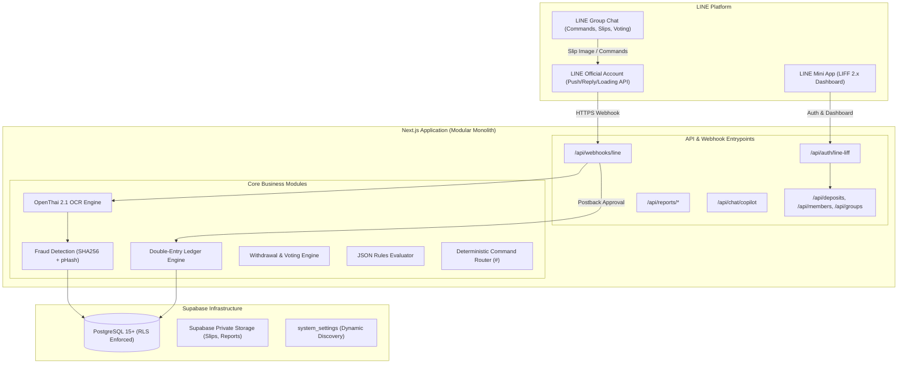

# Money Pool (Bank Buddy) — v.beta 🚀

[](package.json)
[](#features-vbeta)
[-brightgreen.svg)](#testing--quality-gates)
[](package.json)

**Money Pool (Bank Buddy)** is an enterprise-grade financial management platform designed for friend groups, travel clubs, project pools, and shared social circles. It utilizes **LINE Group Chat** as the primary interactive conversational channel and the **LINE Mini App (LIFF)** as the secure member dashboard and administrative portal.

The system is built as a robust **Modular Monolith** powered by an immutable, append-only **Financial Accounting Ledger** backed by **Supabase PostgreSQL** with strict **Row Level Security (RLS)**.

---

## 🌟 Key Features (v.beta)

### 1. Dual-Channel Interaction Architecture
- **LINE Group Chat:** Instant commands (`#ยอดรวม`, `#ยอดฉัน`, `#ช่วยเหลือ`), deposit slips upload, in-chat interactive Flex Cards, and withdrawal voting.
- **LINE Mini App (LIFF 2.x):** Member registration, personal deposit timeline, member roster & role management, financial rules configuration, report export, and AI financial copilot.

### 2. High-Performance Local Thai Slip OCR (OpenThai 2.1)
- **Local Neural Engine:** Powered by `OpenThai 2.1` (PP-OCRv6 + Thai CTC recognizer) with CPU acceleration (OpenVINO / ONNX Runtime).
- **Sub-Second Processing:** Extracts data in 100–300ms locally without sending confidential slip images to external third-party cloud OCR APIs.
- **Multi-Bank Slip Extraction:** Supports major Thai banks including **KBank, SCB, KTB, BBL, BAY, TTB, GSB, and PromptPay**.
- **Resilient Regex & Date Parsing:** Normalizes various Thai and Buddhist calendar (พ.ศ.) date-time formats and handles stylized loopless fonts (Kanit, Prompt).
- **Fallback Engine:** Graceful fallback to embedded Tesseract.js OCR engine if needed.

### 3. Dynamic Service Discovery & Tunneling Automation
- **All-in-One Runner (`npm run dev:all` / `npm run start:all`):** One single command starts the local OCR server, establishes an encrypted public tunnel via `ngrok.exe` (or Cloudflare Tunnel), dynamically updates the Supabase `system_settings` table, and boots the Next.js application.
- **Zero Vercel Re-deployments:** Cloud Vercel Serverless automatically discovers the active local OCR endpoint from Supabase database in real-time.

### 4. Deterministic In-Chat Verification & Race Condition Protection
- **Instant LINE Loading Animation:** Triggers `POST /v2/bot/chat/loading/start` immediately upon user action for instant UX feedback.
- **Atomic State Locking:** Uses conditional database atomic locks (`UPDATE deposits SET status = 'processing' WHERE id = :id AND status = 'pending'`) to guarantee that concurrent button clicks never result in duplicate credit entries.

### 5. Multi-Layered Slip Fraud Prevention
- **Binary Hash Deduplication (SHA-256):** Rejects re-uploaded identical files.
- **Perceptual Hashing (pHash):** Identifies cropped, filtered, resized, or cosmetically altered slips.
- **Heuristic Risk Scoring:** Computes risk scores based on transfer timing, round amounts, bank reference anomalies, and flags suspicious slips for human review.
- **Extensible Verification Provider:** Pluggable Strategy pattern ready for direct bank clearing and reconciliation APIs.

### 6. Immutable Financial Ledger & Double-Entry Accounting
- Strict separation between raw slips and verified financial transactions.
- Running balances are derived exclusively from append-only `ledger_entries` (`credit` and `debit`).
- Direct balance updates are prohibited by database RLS rules and architectural constraints.

### 7. Democratic Group Voting for Withdrawals
- Transparent withdrawal requests requiring mandatory invoice/receipt upload.
- Interactive LINE Group voting cards (`[เห็นชอบ]` / `[ไม่เห็นชอบ]`).
- Configurable quorum thresholds (`group_settings.voting_quorum_percent`); commits automatic ledger debit once quorum is reached.

### 8. Dynamic Rules & Financial Reports
- **JSON Schema Financial Rules:** Configurable recurring targets, due dates, minimum contributions, and compliance status indicators.
- **Multi-Format Export:** Asynchronous generation of detailed Excel spreadsheets (`exceljs`) and PDF reports.

---

## 🏗️ System Architecture



---

## 📋 Prerequisites

- **Node.js**: v20+ (Tested on Node v26.13.1)
- **Python**: 3.12 (For OpenThai 2.1 OCR Engine)
- **Docker & Docker Compose**: Active Docker daemon for local PostgreSQL, GoTrue Auth, and MinIO Storage
- **uv** (recommended for ultra-fast Python venv setup) or standard `python -m venv`
- **ngrok** account (optional, `ngrok.exe` placed in root for tunneling)

---

## 🚀 Quick Start Guide

### 1. Install Node Dependencies

```bash
npm install
```

### 2. Configure Environment Variables

Copy the example environment file and update your credentials:

```bash
cp .env.example .env.local
```

Configure:
- `LINE_CHANNEL_SECRET` & `LINE_CHANNEL_ACCESS_TOKEN` (from [LINE Developers Console](https://developers.line.biz/))
- `NEXT_PUBLIC_LIFF_ID` (LINE Mini App ID)
- `NEXT_PUBLIC_SUPABASE_URL` & `SUPABASE_SERVICE_ROLE_KEY`
- `NGROK_AUTHTOKEN` (if utilizing ngrok tunnel)

### 3. Start Local Supabase Services (Docker)

```bash
docker compose up -d postgres supabase-auth supabase-storage
```

### 4. Setup Local OpenThai 2.1 OCR Model

```bash
# Automatically creates Python 3.12 virtualenv and installs ONNX/OpenVINO dependencies
npm run ocr:setup
```

### 5. Launch Full Stack (All-in-One Runner)

```bash
# Development Mode (OCR Server + Tunnel Auto-Sync + Next.js App):
npm run dev:all

# Or Production Mode:
npm run build && npm run start:all
```

*The runner boots the local OCR engine, detects `ngrok.exe` (or falls back to Cloudflare Tunnel), updates Supabase `system_settings` for remote discovery, and launches the web application.*

Visit the Mini App Dashboard: [http://localhost:3000/overview](http://localhost:3000/overview)

---

## 🧪 Testing & Quality Gates

All test suites and TypeScript checks pass 100%:

```bash
# Run TypeScript compilation check (0 errors)
npm run type-check

# Run full test suite (16 suites, 135 passing tests)
npm test

# Run tests by domain
npm run test:unit          # OCR parser, command router, ledger balance, rules, fraud
npm run test:integration   # Deposit state machine, LINE events, voting quorum
npm run test:security      # Supabase Row Level Security (RLS) isolation
```

---

## 📂 Repository Structure

```
├── docs/                    # Design specifications & system architecture
│   └── designs/
│       ├── money_pool_master_design.md
│       ├── money_pool_phase1_mvp.md
│       └── SITEMAP.md
├── scripts/                 # Automation & runner utilities
│   ├── start-all.py         # All-in-one runner (OCR + Tunnel + Next.js)
│   └── start-ocr-tunnel.py  # Standalone OCR & tunnel synchronizer
├── src/
│   ├── app/                 # Next.js App Router (LIFF Mini App & APIs)
│   │   ├── (mini-app)/      # Overview, Deposits, Members, Review, Settings, Reports
│   │   └── api/             # Webhooks, Auth, Deposits, Reports, Copilot
│   ├── integrations/        # Supabase client/server adapters
│   ├── modules/             # Core business logic
│   │   ├── ai/              # Hybrid AI Copilot & Privacy filter
│   │   ├── commands/        # Deterministic # command router
│   │   ├── deposits/        # Deposit workflow & state machine
│   │   ├── fraud/           # SHA256, pHash & heuristic risk evaluation
│   │   ├── jobs/            # Asynchronous background job runner
│   │   ├── ledger/          # Double-entry ledger calculation
│   │   ├── line-webhook/    # LINE Messaging API client & flex templates
│   │   ├── membership/      # RBAC & membership lifecycle
│   │   ├── ocr/             # OpenThai 2.1 extractor & multi-bank parser
│   │   ├── reports/         # Excel & PDF export generators
│   │   ├── rules/           # JSON Schema financial rule evaluator
│   │   └── withdrawals/     # Democratic voting & payout engine
│   └── shared/              # Reusable UI components, contexts, and schemas
├── supabase/                # PostgreSQL migrations, seed data & RLS policies
├── tests/                   # 135 Unit, Integration & Security test cases
└── third_party/             # OpenThai 2.1 OCR engine models & server
```

---

## 📄 License & Attribution

Internal Release — **Bank Buddy v.beta**. Developed with Google Antigravity.
