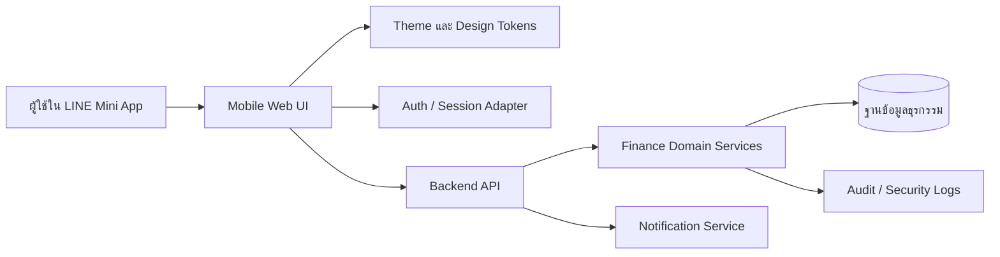

# SYSTEM_DESIGN.md — Bank Buddy LINE Mini App

> **สถานะเอกสาร:** แนวทางออกแบบและสถาปัตยกรรมเบื้องต้น (Proposed)  
> **ผลิตภัณฑ์:** Bank Buddy — “เพื่อนพึ่งพายามยาก”  
> **แพลตฟอร์มเป้าหมาย:** เว็บแอปบนมือถือที่เปิดใช้งานผ่าน LINE Mini App  
> **หมายเหตุ:** ยอดเงินและรายการธุรกรรมในภาพจำลองเป็นข้อมูลตัวอย่างเท่านั้น

## 1. เป้าหมายการออกแบบ

Bank Buddy ควรให้ผู้ใช้ดูภาพรวมการเงินและเข้าถึงงานสำคัญได้รวดเร็วบนหน้าจอมือถือ โดยมีลำดับการอ่านชัดเจน ใช้งานด้วยนิ้วได้สะดวก และรักษาความอ่านง่ายทั้งในโหมดสว่างและโหมดมืด

หลักการสำคัญ:

- **ชัดก่อนสวย:** ยอดเงิน สถานะ และปุ่มหลักต้องเด่นและเข้าใจได้ทันที
- **สีมีความหมาย:** ใช้สีเขียวกับการกระทำหลัก/สถานะบวก สีแดงกับข้อผิดพลาดหรือการดำเนินการที่มีความเสี่ยง ไม่ใช้สีเพียงอย่างเดียวในการสื่อความหมาย
- **แยกประเภทปุ่ม:** ผู้ใช้ต้องแยกปุ่มหลัก ปุ่มรอง และปุ่มอันตรายได้จากสี รูปทรง และข้อความ
- **ธีมสอดคล้องกัน:** ทุกหน้าจอและส่วนประกอบอ่านได้ในทั้งสองธีม รวมถึงสถานะ hover, pressed, disabled และ focus
- **มือถือเป็นหลัก:** ออกแบบสำหรับจอแคบก่อน และปรับตามความกว้างหน้าจอโดยไม่ทำให้เนื้อหาล้น

## 2. โครงสร้างหน้าหลัก

1. **แถบหัวแอป:** เครื่องหมาย Bank Buddy, ชื่อแอป และทางเข้าการแจ้งเตือน/การตั้งค่า
2. **คำทักทายและบริบท:** ข้อความสั้น ไม่แย่งความเด่นจากข้อมูลการเงิน
3. **การ์ดยอดเงิน:** ยอดเงินคงเหลือเป็นจุดสนใจหลัก พร้อมปุ่มดูรายละเอียด
4. **เมนูทางลัด:** โอนเงิน, เติมเงิน, จ่ายบิล และประวัติ แสดงเป็นการ์ดแยกกัน
5. **รายการล่าสุด:** แสดงชื่อรายการ วันที่ และจำนวนเงิน พร้อมเครื่องหมายบวก/ลบหรือป้ายประเภท
6. **แถบนำทางด้านล่าง:** หน้าหลัก, บัญชี, กิจกรรม และตั้งค่า โดยระบุหน้าปัจจุบันให้ชัดเจน

## 3. ระบบสี (Design Tokens)

### 3.1 โหมดสว่าง

| Token | สี | ใช้กับ |
|---|---|---|
| `brand-700` | `#075C4D` | ปุ่มหลัก, ลิงก์สำคัญ, ไอคอนที่เลือก |
| `brand-800` | `#06483F` | หัวข้อเด่นและพื้นการ์ดยอดเงิน |
| `brand-100` | `#DDF4EA` | พื้นหลังไอคอน/ส่วนเน้นอ่อน |
| `page-bg` | `#F5F9F7` | พื้นหลังหน้าจอ |
| `surface` | `#FFFFFF` | การ์ด เมนู และแถบนำทาง |
| `text-primary` | `#173D35` | หัวข้อและข้อความหลัก |
| `text-secondary` | `#647B74` | คำอธิบายและข้อมูลรอง |
| `border` | `#DCE8E2` | เส้นแบ่งและขอบควบคุม |
| `positive` | `#087963` | เงินเข้า/สถานะสำเร็จ พร้อมเครื่องหมาย `+` หรือป้าย |
| `negative` | `#B83A36` | เงินออก/ข้อผิดพลาด พร้อมเครื่องหมาย `−` หรือป้าย |
| `warning` | `#9A6500` | คำเตือนที่ยังไม่ถึงขั้นผิดพลาด |

พื้นสีสำหรับการ์ดยอดเงินใช้เขียวเข้ม `#075C4D` ถึง `#06483F` โดยให้ตัวเลขสีขาวและหลีกเลี่ยงลวดลายหรือเอฟเฟกต์ที่รบกวนการอ่าน

### 3.2 โหมดมืด

| Token | สี | ใช้กับ |
|---|---|---|
| `page-bg` | `#101815` | พื้นหลังหน้าจอ |
| `surface` | `#19231F` | การ์ด เมนู และแถบนำทาง |
| `surface-raised` | `#22312B` | การ์ดที่ยกชั้น/เมนูที่ถูกเลือก |
| `brand-300` | `#82D9B2` | ปุ่มหลัก ลิงก์ และสถานะที่เลือก |
| `brand-900` | `#063B32` | พื้นการ์ดแบรนด์/ส่วนหัวที่ต้องการความเข้ม |
| `text-primary` | `#F2F7F4` | หัวข้อและข้อความหลัก |
| `text-secondary` | `#B2C2BB` | คำอธิบายและข้อมูลรอง |
| `border` | `#34443D` | เส้นแบ่งและขอบควบคุม |
| `positive` | `#82D9B2` | เงินเข้า/สถานะสำเร็จ |
| `negative` | `#FF8A80` | เงินออก/ข้อผิดพลาด |
| `warning` | `#FFD166` | คำเตือน |

หลีกเลี่ยงการใช้สีดำสนิทเป็นพื้นหลักและสีเขียวเรืองแสงเป็นข้อความยาว เพื่อให้สบายตาและคงลำดับความสำคัญของข้อมูล

### 3.3 ตัวแปรธีมตัวอย่าง

```css
:root,
[data-theme="light"] {
  color-scheme: light;
  --page-bg: #F5F9F7;
  --surface: #FFFFFF;
  --surface-raised: #FFFFFF;
  --brand: #075C4D;
  --brand-strong: #06483F;
  --brand-soft: #DDF4EA;
  --text-primary: #173D35;
  --text-secondary: #647B74;
  --border: #DCE8E2;
  --positive: #087963;
  --negative: #B83A36;
  --warning: #9A6500;
}

[data-theme="dark"] {
  color-scheme: dark;
  --page-bg: #101815;
  --surface: #19231F;
  --surface-raised: #22312B;
  --brand: #82D9B2;
  --brand-strong: #063B32;
  --brand-soft: #203D32;
  --text-primary: #F2F7F4;
  --text-secondary: #B2C2BB;
  --border: #34443D;
  --positive: #82D9B2;
  --negative: #FF8A80;
  --warning: #FFD166;
}
```

ทุกส่วนประกอบควรอ้างอิงตัวแปรสี ไม่กำหนดสีเฉพาะจุดโดยไม่จำเป็น เพื่อให้สลับธีมได้ครบทั้งหน้า

## 4. ตัวอักษรและลำดับหัวข้อ

ใช้ฟอนต์ sans-serif ที่รองรับภาษาไทย เช่น **Noto Sans Thai** หรือฟอนต์ระบบที่มี fallback เหมาะสม ขนาดด้านล่างเป็น CSS pixels และควรทดสอบบนอุปกรณ์จริง

| ระดับ | ขนาด/น้ำหนัก | ตัวอย่างการใช้ |
|---|---:|---|
| `display` | 28–32 px / 700–800 | ยอดเงินหลักหรือหัวข้อเปิดหน้า (ใช้เท่าที่จำเป็น) |
| `title-1` | 24 px / 700 | ชื่อหน้าหลัก |
| `title-2` | 18–20 px / 700 | หัวข้อส่วน เช่น “รายการล่าสุด” |
| `title-3` | 16 px / 600–700 | ชื่อการ์ด/ชื่อรายการ |
| `body` | 14–16 px / 400–500 | ข้อความทั่วไปและปุ่ม |
| `caption` | 12–13 px / 400–500 | วันที่ คำใบ้ และสถานะรอง |

แนวทางปรับจากแบบเดิม:

- ตั้งหัวข้อหน้าหลักเป็น **24 px** แทนข้อความขนาดใกล้ body เพื่อให้เห็นลำดับชัดขึ้น
- หัวข้อส่วนใช้ **18 px** และชื่อรายการ/การ์ดใช้ **16 px**
- หลีกเลี่ยงข้อความสำคัญที่เล็กกว่า **12 px**; วันที่และคำอธิบายรองใช้สีที่ยังอ่านได้ในทั้งสองธีม
- ยอดเงินใช้ตัวเลขแบบ tabular ถ้าฟอนต์รองรับ เพื่อให้หลักตัวเลขเรียงตรงกัน
- ใช้ตัวหนาเพื่อสร้างลำดับ ไม่ใช้ตัวหนากับทุกข้อความ

## 5. ปุ่มและการแยกบทบาท

### 5.1 ปุ่มหลัก (Primary)

- ใช้กับการกระทำหลักของบริบท เช่น “โอนเงิน” หรือ “ยืนยัน”
- พื้น `brand-700` ในโหมดสว่าง และ `brand-300` ในโหมดมืด พร้อมสีข้อความที่มี contrast สูง
- ความสูงอย่างน้อย **48 px**, มุมโค้ง **12–14 px**, น้ำหนักข้อความ 600–700
- ต่อหนึ่งพื้นที่/ฟอร์มมีปุ่มหลักเด่นที่สุดเพียงหนึ่งปุ่ม

### 5.2 ปุ่มรอง (Secondary)

- ใช้กับทางเลือกที่สำคัญรองลงมา เช่น “ดูรายละเอียด”
- พื้นเป็น `surface`, ขอบ 1 px `brand`, ข้อความ `brand`
- ใช้ขนาดและระยะห่างต่างจากปุ่มหลักอย่างชัดเจน แต่ยังมีพื้นที่กดอย่างน้อย **44 × 44 px**

### 5.3 ปุ่มย่อย (Tertiary / Text)

- ใช้กับลิงก์หรือการกระทำที่ไม่ใช่จุดหลัก เช่น “ดูทั้งหมด”
- ไม่มีพื้นการ์ดหรือขอบแบบปุ่มหลัก ใช้สีแบรนด์และมีสถานะ focus ที่มองเห็นได้

### 5.4 ปุ่มอันตรายและสถานะ

- การลบ/ยกเลิกถาวรใช้โทน `negative` และให้มีข้อความยืนยันที่ชัดเจน
- ปุ่ม disabled ต้องลดความเด่นแต่ยังอ่านข้อความได้ ห้ามใช้ความโปร่งใสจนข้อความหาย
- มีสถานะอย่างน้อย `default`, `pressed`, `focus-visible`, `disabled`, `loading`
- ไอคอนอย่างเดียวต้องมีชื่อที่เข้าถึงได้และพื้นที่กดอย่างน้อย **44 × 44 px**

### 5.5 เมนูทางลัด

เมนู “โอนเงิน”, “เติมเงิน”, “จ่ายบิล”, “ประวัติ” ควรแยกเป็นการ์ดหรือปุ่มที่มีพื้นผิวชัดเจน มีไอคอนกับข้อความครบ ไม่พึ่งสีเพียงอย่างเดียว และเว้นช่องว่างระหว่างปุ่มอย่างน้อย **8–12 px** เพื่อป้องกันการกดผิด

## 6. การสลับโหมดสว่าง/มืด

เพิ่มการตั้งค่าธีมในหน้า **ตั้งค่า > รูปลักษณ์** เป็นตัวเลือก 3 แบบ:

- **ตามระบบ (ค่าเริ่มต้น):** ใช้ค่าธีมของอุปกรณ์
- **สว่าง:** บังคับใช้ธีมสว่าง
- **มืด:** บังคับใช้ธีมมืด

พฤติกรรมที่กำหนด:

1. อ่านค่าที่ผู้ใช้เลือกก่อน หากไม่มีค่าบันทึก ให้ตรวจค่าธีมของระบบ
2. เมื่อผู้ใช้เปลี่ยนตัวเลือก ให้อัปเดตทั้งหน้าทันทีโดยไม่ reload
3. บันทึกค่าที่เลือกใน local storage หรือกลไกเก็บค่าฝั่ง client ที่เหมาะสม และแยกจากข้อมูลธุรกรรม
4. เมื่อเลือก “ตามระบบ” ให้ตอบสนองต่อการเปลี่ยนค่าธีมของระบบ
5. คงธีมเดียวกันตลอดทุกหน้า รวมถึง dialog, toast, loading, empty state และกราฟ
6. ใช้ปุ่มเลือกแบบ segmented หรือ radio ที่มีป้าย “ตามระบบ / สว่าง / มืด” ชัดเจน ไม่ใช้ไอคอนดวงอาทิตย์/ดวงจันทร์อย่างเดียว

ตัวอย่างการตรวจค่าระบบ:

```js
const systemPrefersDark = window.matchMedia('(prefers-color-scheme: dark)').matches;
const savedTheme = localStorage.getItem('bank-buddy-theme'); // system | light | dark

function resolveTheme(choice = savedTheme ?? 'system') {
  if (choice === 'system') return systemPrefersDark ? 'dark' : 'light';
  return choice;
}

document.documentElement.dataset.theme = resolveTheme();
```

ในงานจริงควร subscribe การเปลี่ยนแปลง `matchMedia` เมื่อผู้ใช้เลือก “ตามระบบ” และจัดการค่าที่อ่านไม่ได้อย่างปลอดภัย

## 7. เลย์เอาต์และการตอบสนองต่อหน้าจอ

- ใช้ mobile-first; ระยะขอบเนื้อหาประมาณ **16–20 px** บนจอมือถือ
- การ์ดยอดเงินเต็มความกว้างที่ใช้ได้; แสดงยอดและป้ายบริบทให้เห็นพร้อมกัน
- เมนูทางลัดเรียง 2 × 2 เมื่อพื้นที่แคบ หรือ 4 คอลัมน์เมื่อความกว้างเพียงพอ
- แถบนำทางด้านล่างต้องไม่บังเนื้อหา และคำนึงถึง safe area ของอุปกรณ์
- ข้อความยาวต้องตัดบรรทัดหรือย่ออย่างเหมาะสม ห้ามทับยอดเงินหรือปุ่ม
- ระยะห่างใช้สเกลคงที่ เช่น 4, 8, 12, 16, 24, 32 px; มุมโค้งการ์ด 16–20 px

## 8. สถาปัตยกรรมระบบเบื้องต้น



### ส่วนประกอบ

- **Mobile Web UI:** หน้าหลัก การ์ดยอดเงิน เมนูทางลัด ประวัติ และการตั้งค่าธีม
- **Theme layer:** จัดการ tokens, ค่าตามระบบ และค่าที่ผู้ใช้เลือก
- **Auth / Session Adapter:** แยกการตรวจ session/ตัวตนของผู้ใช้จาก UI และไม่เก็บ secret ใน client
- **Backend API:** ตรวจสิทธิ์และตรวจข้อมูลทุกคำขอที่เกี่ยวกับบัญชี/ธุรกรรม
- **Finance Domain Services:** คำนวณยอด แสดงธุรกรรม และจัดการคำสั่งทางการเงินตามสิทธิ์
- **ฐานข้อมูล:** เก็บข้อมูลด้วยสิทธิ์เข้าถึงขั้นต่ำ มีการสำรองข้อมูลและนโยบาย retention ที่ชัดเจน
- **Audit / Security Logs:** บันทึกเหตุการณ์สำคัญโดยไม่บันทึก secret หรือข้อมูลอ่อนไหวเกินจำเป็น

### หลักความปลอดภัยขั้นต่ำ

- ตรวจสิทธิ์ฝั่ง server ทุกครั้ง ห้ามเชื่อยอดเงินหรือสิทธิ์ที่ส่งมาจาก client
- ใช้การเชื่อมต่อเข้ารหัสและจัดการ secret ผ่านระบบฝั่ง server
- ป้องกันการส่งคำสั่งซ้ำด้วย idempotency เมื่อมีธุรกรรมที่เปลี่ยนสถานะ
- แสดงสถานะรอดำเนินการ/สำเร็จ/ไม่สำเร็จอย่างชัดเจน และไม่แสดงว่าทำรายการสำเร็จก่อน server ยืนยัน
- ไม่ใช้ข้อมูลเงินจริงในภาพตัวอย่าง เอกสารทดสอบ หรือ analytics โดยไม่มีมาตรการคุ้มครอง

> โครงสร้างนี้เป็นข้อเสนอระดับสูง ยังไม่ระบุผู้ให้บริการ backend, ฐานข้อมูล, payment provider หรือรายละเอียดการเชื่อมต่อ LINE เพราะต้องยืนยันจากข้อกำหนดทางธุรกิจและระบบจริงก่อนพัฒนา

## 9. สถานะและการเข้าถึง

ทุกหน้าที่โหลดข้อมูลควรมีสถานะ:

- **Loading:** skeleton หรือ placeholder ที่ไม่ทำให้ผู้ใช้เข้าใจผิดว่าเป็นยอดจริง
- **Empty:** อธิบายว่าที่ยังไม่มีรายการ พร้อมทางไปทำรายการที่เกี่ยวข้อง
- **Error:** แจ้งสิ่งที่เกิดขึ้นด้วยภาษาง่ายและมีวิธีลองใหม่
- **Success:** ยืนยันสถานะจากผลตอบกลับของระบบ

เป้าหมายการเข้าถึง:

- คอนทราสต์ข้อความทั่วไปอย่างน้อย **4.5:1** และข้อความขนาดใหญ่/องค์ประกอบ UI อย่างน้อย **3:1**
- รองรับการใช้งานด้วย keyboard/focus และ screen reader ผ่าน label ที่สื่อความหมาย
- ห้ามสื่อสถานะเงินเข้า/ออกด้วยสีอย่างเดียว ต้องมีเครื่องหมายหรือข้อความกำกับ
- ปุ่มและพื้นที่สัมผัสมีขนาดเหมาะกับนิ้วบนมือถือ

## 10. เกณฑ์ตรวจรับ

- [ ] สลับ `ตามระบบ / สว่าง / มืด` ได้ และมีผลครบทุกส่วนประกอบ
- [ ] สถานะธีมที่ผู้ใช้เลือกคงอยู่เมื่อกลับมาเปิดแอปอีกครั้ง
- [ ] ชื่อหน้าและหัวข้อส่วนมีขนาดตามลำดับ และไม่ชนกับแถบสถานะ/ขอบจอ
- [ ] ปุ่มหลัก ปุ่มรอง และปุ่มย่อยแตกต่างกันด้วยพื้นผิว/ขอบ/น้ำหนักตัวอักษร
- [ ] ปุ่มหลักสูงอย่างน้อย 48 px และเป้าหมายกดทั่วไปไม่น้อยกว่า 44 × 44 px
- [ ] ยอดเงิน วันที่ และรายการธุรกรรมไม่ล้นการ์ดที่ความกว้างหน้าจอเป้าหมาย
- [ ] สีข้อความและองค์ประกอบสำคัญผ่านการตรวจ contrast ในทั้งสองธีม
- [ ] ข้อมูลใน mockup ระบุชัดว่าเป็นข้อมูลตัวอย่าง
- [ ] การทำรายการจริงได้รับผลยืนยันจาก server และจัดการสถานะผิดพลาดได้
