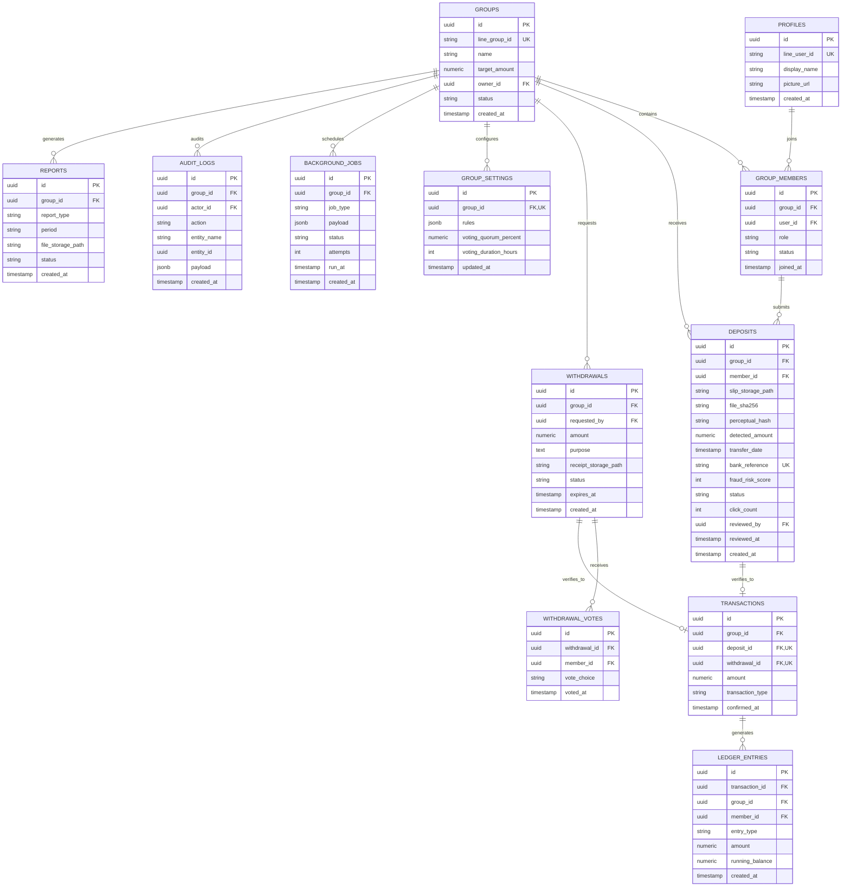
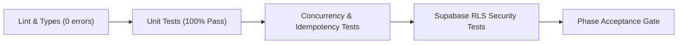

# Money Pool (Bank Buddy) — Comprehensive Multi-Phase Master Design Document

* **Author:** NB-Psave / Bank Buddy Team
* **Status:** v.beta (Implementation Complete — All Phases 1-3 Unified & Validated)
* **Date:** 2026-11-22
* **Architecture Style:** Modular Monolith (Next.js 15+ + TypeScript + Local/Cloud Supabase + Docker)
* **Scope:** Full Lifecycle Roadmap (Phase 1: Foundation & MVP $\rightarrow$ Phase 2: Automation & Intelligence $\rightarrow$ Phase 3: Advanced Money Pool)
* **Test Metrics:** 16 Test Suites, 135 Passed Tests (100% Pass Rate), 0 Type Errors

---

## 1. Executive Summary & Vision

Money Pool (Bank Buddy) is an enterprise-grade financial management system engineered for friend groups, travel clubs, and shared social circles. The platform leverages the **LINE Group Chat** as the primary interactive conversational channel, and the **LINE Mini App (LIFF)** as the secure member dashboard and administrative portal.

The system is architected as an extensible **Modular Monolith** driven by an immutable, append-only **Financial Accounting Ledger** backed by **Supabase PostgreSQL** with strict **Row Level Security (RLS)**.

To ensure long-term stability, development is structured into three progressive phases:
1. **Phase 1 (Foundation & MVP):** Local containerized Supabase, LINE Group Webhook, strict LIFF member onboarding, local Tesseract.js slip OCR, deterministic `#` command router, in-chat idempotent postback approvals with instant LINE typing indicator, and append-only ledger entries.
2. **Phase 2 (Automation & Intelligence):** Multi-layered in-house slip fraud detection (SHA-256 + Perceptual Hash + Risk Score) with extensible `VerificationProviderInterface`, transactional background jobs via PostgreSQL `pg_cron`, and Hybrid AI (On-Demand `@Bot` in LINE Group + Full Copilot in Mini App).
3. **Phase 3 (Advanced Money Pool):** Democratic Group Voting withdrawal workflow in LINE chat, dynamic JSON Schema financial rules engine, background asynchronous PDF/Excel report generator, advanced membership lifecycle, and explainable AI insights.

---

## 2. Master System Architecture

```mermaid
flowchart TB
    subgraph LINE_PLATFORM["LINE Platform"]
        LGC["LINE Group Chat (Commands, Slips, Voting)"]
        LOA["LINE Official Account (Push/Reply/Loading API)"]
        LIFF["LINE Mini App (LIFF 2.x Dashboard)"]
    end

    subgraph APP_CONTAINER["Next.js Application (Modular Monolith)"]
        subgraph ROUTE_HANDLERS["API & Webhook Entrypoints"]
            WH["/api/webhooks/line"]
            AUTH_API["/api/auth/line-liff"]
            MINI_API["/api/mini-app/*"]
            REPORT_API["/api/reports/*"]
        end

        subgraph INTEGRATIONS["Integration Adapters"]
            LINE_ADAPTER["LINE Messaging API Client"]
            OCR_ADAPTER["OpenThai 2.1 Local OCR (OpenVINO / ONNX)"]
            STORAGE_ADAPTER["Supabase Storage Client (Private)"]
            AI_ADAPTER["LLM / Local AI Adapter"]
            VERIFY_PROVIDER["Verification Provider Interface (Strategy)"]
        end

        subgraph BUSINESS_MODULES["Core Business Logic Layer"]
            MEMBERSHIP_MOD["Membership & RBAC Module"]
            SLIP_MOD["Slip Processing & State Machine"]
            FRAUD_MOD["Slip Fraud Detection (pHash, SHA256)"]
            LEDGER_MOD["Double-Entry Financial Ledger Engine"]
            WITHDRAWAL_MOD["Withdrawal & Group Voting Engine"]
            RULE_MOD["Configurable Financial Rules Evaluator"]
            COMMAND_MOD["Deterministic Command Router (#)"]
            AI_ROUTER["Hybrid Intent Router & Copilot"]
            JOB_MOD["Background Job Worker (pg_cron listener)"]
            REPORT_MOD["Async PDF & Excel Export Generator"]
        end

        subgraph FRONTEND_UI["LINE Mini App UI (Next.js App Router)"]
            OVERVIEW_UI["Overview & Financial Goals"]
            MY_DEP_UI["Personal Deposits & History"]
            MEMBERS_UI["Member Roster & Approvals"]
            REVIEW_UI["Slip Review & Adjustments"]
            SETTINGS_UI["Group Rules & Thresholds"]
            REPORT_UI["Financial Reports & Analytics"]
            COPILOT_UI["Mini App AI Financial Copilot"]
        end
    end

    subgraph SUPABASE_INFRA["Supabase Infrastructure (Local Docker / Cloud)"]
        PG_DB[("PostgreSQL 15+ (RLS Enforced)")]
        PG_CRON["pg_cron Scheduler Extension"]
        GO_TRUE["GoTrue Auth Service"]
        MINIO_STORAGE["Supabase Storage (Private Buckets)"]
    end

    %% Webhook & Auth
    LGC -->|"User sends message / slip / vote"| LOA
    LOA -->|"HTTPS Webhook POST"| WH
    WH -->|"HMAC-SHA256 Signature Check"| LINE_ADAPTER
    LIFF -->|"ID Token + Requests"| AUTH_API
    AUTH_API -->|"Verify with LINE & Sign JWT"| GO_TRUE

    %% Slip Pipeline
    WH -->|"Slip Image"| SLIP_MOD
    SLIP_MOD -->|"Stream Image"| STORAGE_ADAPTER
    STORAGE_ADAPTER --> MINIO_STORAGE
    SLIP_MOD -->|"Extract Text"| OCR_ADAPTER
    SLIP_MOD -->|"Check Duplicate Hash / Risk"| FRAUD_MOD
    FRAUD_MOD -.->|"Optional External Clearing"| VERIFY_PROVIDER
    SLIP_MOD -->|"Pending Record"| PG_DB

    %% In-Chat Postback & Voting Pipeline
    WH -->|"Postback Action"| SLIP_MOD
    SLIP_MOD -->|"Trigger Loading Start"| LINE_ADAPTER
    LINE_ADAPTER -->|"POST /v2/bot/chat/loading/start"| LOA
    SLIP_MOD -->|"Atomic State Lock & Commit"| LEDGER_MOD
    LEDGER_MOD -->|"Append-Only Ledger Entry"| PG_DB

    %% Command & AI Pipeline
    WH -->|"Text starts with #"| COMMAND_MOD
    WH -->|"Text mentions @Bot"| AI_ROUTER
    COMMAND_MOD -->|"Fetch Ledger Balance"| LEDGER_MOD
    AI_ROUTER -->|"Strict Query Tools Only"| LEDGER_MOD
    AI_ROUTER -->|"Channel Context Guard"| AI_ADAPTER
    COMMAND_MOD -->|"Reply Flex Message"| LINE_ADAPTER

    %% Mini App Pipeline
    LIFF -->|"Fetch Data"| MINI_API
    MINI_API -->|"Validate Session & RLS"| PG_DB
    FRONTEND_UI -->|"Render Views"| MINI_API
    COPILOT_UI -->|"Multi-turn Analytical Queries"| AI_ROUTER

    %% Automation & Reports
    PG_CRON -->|"Trigger Scheduled Dispatch"| JOB_MOD
    JOB_MOD -->|"Execute Reminders & Summaries"| LINE_ADAPTER
    JOB_MOD -->|"Asynchronous Report Tasks"| REPORT_MOD
    REPORT_MOD -->|"Store PDF / XLSX"| STORAGE_ADAPTER
```

---

## 3. Multi-Phase Architecture Decisions & Roadmap

| Architectural Dimension | Phase 1 (Foundation & MVP) | Phase 2 (Automation & Intelligence) | Phase 3 (Advanced Money Pool) |
|---|---|---|---|
| **Database Environment** | Local Supabase via Docker (PostgreSQL 15, RLS, Auth, Storage) | Local / Dedicated Cloud Supabase Instance with `pg_cron` | Production Cloud Supabase Cluster with Automated Replication |
| **Slip OCR & Extraction** | Local OpenThai 2.1 OCR (OpenVINO / ONNX, ~100-300ms) + Regex Parser | OpenThai 2.1 HTTP Daemon + CLI Runner with Tesseract Fallback | Extensible Multi-Provider OCR (OpenThai / OpenVINO On-Prem) |
| **Slip Fraud Prevention** | Basic Bank Reference Number Deduplication | Multi-Layered In-House Engine (SHA-256 + pHash + Risk Score) | Pluggable `VerificationProviderInterface` (SlipOK / Bank Reconciler) |
| **Chat Interaction** | Deterministic Command Prefix (`#ยอดรวม`, `#ยอดฉัน`, `#ช่วยเหลือ`) | Hybrid AI: On-Demand Quick AI via `@Bot` mention in Group | Context-Aware Group Assistant + Voting Interactions |
| **Mini App Intelligence** | Static Dashboard & Financial Overview | Full AI Financial Copilot (Multi-turn, Charts, Analytics) | Explainable AI Financial Insights & Trend Predictor |
| **Approval Workflow** | Inline Group Postback with Loading Animation & Idempotency Lock | In-Chat Postback + Mini App Adjustments + Suspicious Queue | Group Democratic Voting Workflow for Withdrawals |
| **Membership Onboarding** | Strict LIFF Registration + Owner/Treasurer Approval | In-App Role Management + Activity Audit Tracking | Multi-Tier Roles, Temporary Admin, Member Suspension |
| **Financial Rules** | Single Active Pool per Group with Fixed Goal | Scheduled Deposit Reminders & Deadline Tracking | Dynamic JSON Schema Rules Engine (Due Dates, Excess Handling) |
| **Background Automation** | Webhook Synchronous Processing + Immediate Acknowledgement | Database-Driven Job Queue (`background_jobs`) + `pg_cron` | Asynchronous Job Engine with Retry & Dead-Letter Handling |
| **Financial Reporting** | In-App Dashboard Summary Views | Visual Charts & Monthly Summaries in Mini App | Asynchronous Server-side PDF (`@react-pdf`) & Excel (`exceljs`) |

---

## 4. Master Database Schema Specification

All tables are strictly governed by PostgreSQL Row Level Security (RLS) policies scoped to `group_id`.

---

## 5. Phase-by-Phase Technical Blueprint

### 5.1 Phase 1 — Foundation & MVP
* **Objective:** Establish the bedrock infrastructure where LINE Group members register via Mini App, upload transfer slips, have them scanned via high-performance local OpenThai 2.1 OCR (OpenVINO / ONNX), and allow Owner/Treasurer to approve via in-chat buttons with loading indicators and idempotent ledger entries.
* **Key Deliverables:**
  1. Next.js 15 App Router setup with Tailwind CSS and shadcn/ui.
  2. Local Docker Compose orchestrating Supabase (PostgreSQL 15, Auth, Storage, Studio).
  3. LINE Webhook handler (`/api/webhooks/line`) with HMAC-SHA256 signature verification.
  4. Local OpenThai 2.1 OCR engine (PP-OCRv6-tiny + Thai CTC recognizer with OpenVINO / ONNX runtime, ~100-300ms) with specialized bank slip parser extracting amount, timestamp, bank name, and reference code. Local Tesseract.js retained as emergency fallback.
  5. **Dynamic Service Discovery & Cloudflare Tunneling:**
     - Cloud Vercel Serverless automatically discovers the active local OCR URL from Supabase `system_settings` (`key: OPENTHAI_OCR_URL`).
     - Automated runner script (`npm run dev:all` / `npm run start:all`) launches the local OCR engine, establishes a Cloudflare Quick Tunnel (`*.trycloudflare.com`), and auto-registers the public URL to Supabase in real-time with background reconnection monitoring.
  6. In-Chat Postback Approval:
     - Immediate `POST /v2/bot/chat/loading/start` trigger.
     - Atomic lock: `UPDATE deposits SET status = 'processing', click_count = click_count + 1 WHERE id = :id AND status = 'pending'`.
     - Transaction commit: writes to `transactions` and `ledger_entries` (entry_type: `credit`).
  7. Strict Onboarding via LINE Mini App (LIFF) with Owner approval gate.
  8. Deterministic command prefix router: `#ยอดรวม`, `#ยอดฉัน`, `#ช่วยเหลือ`.
  9. Mini App MVP views: Overview, My Deposits, Members, Review Dashboard, Settings.

### 5.2 Phase 2 — Automation & Intelligence
* **Objective:** Add proactive background intelligence, scheduled group summaries, comprehensive slip fraud detection, and Hybrid AI assistance.
* **Key Deliverables:**
  1. **Background Jobs Engine:**
     - `background_jobs` table managed transactionally in PostgreSQL.
     - `pg_cron` jobs triggering weekly/monthly group summaries and pending slip alerts.
     - Automatic exponential backoff retries and dead-letter classification.
  2. **Multi-Layered In-House Slip Fraud Detection:**
     - SHA-256 binary hash checking for identical file re-uploads.
     - Perceptual Hashing (pHash / dHash) detecting cropped, color-altered, or filtered duplicate slips.
     - Heuristic Risk Score algorithm (0–100) flagging off-hour transfers, round amounts, or mismatching sender names into a `needs_review` suspicious queue.
     - **`VerificationProviderInterface`:** Pluggable Strategy pattern ready for zero-friction integration of third-party clearing APIs (e.g. SlipOK) or bank statement reconciliation.
  3. **Hybrid AI Channel Integration:**
     - **LINE Group Chat:** On-Demand Quick AI triggered strictly when `@MoneyPoolBot` is mentioned. Uses Business Tool Contracts (`get_group_progress`, `get_unpaid_members`) with strict Group Privacy filtering (never outputs personal balances publicly without authorization).
     - **LINE Mini App:** Full AI Copilot supporting multi-turn conversation, graphical data visualization, monthly trend analysis, and custom natural language inquiries.
  4. **Advanced Mini App Dashboard:**
     - Interactive financial charts (Recharts/Chart.js).
     - Monthly comparison and member payment timeline breakdown.

### 5.3 Phase 3 — Advanced Money Pool
* **Objective:** Complete the financial ecosystem with democratic withdrawals, dynamic financial rules, and automated reporting.
* **Key Deliverables:**
  1. **Group Democratic Withdrawal Workflow:**
     - Withdrawal request submission with mandatory invoice/receipt upload.
     - Interactive Group Voting Flex Message in LINE chat with `[เห็นชอบ]` and `[ไม่เห็นชอบ]` buttons.
     - Quorum tracking based on `group_settings.voting_quorum_percent`.
     - Upon approval quorum reached, commits atomic `debit` entry to `ledger_entries` and dispatches notification.
  2. **Configurable Financial Rules Engine:**
     - Dynamic JSON Schema stored in `group_settings.rules` (minimum deposits, monthly due dates, recurring dues, excess carryover).
     - `RuleEvaluatorService` evaluating member compliance and generating status badges (`on_track`, `due_soon`, `overdue`).
  3. **Asynchronous Financial Reporting Engine:**
     - Background generation of formatted Excel spreadsheets (`exceljs`) and audit-ready PDF reports (`@react-pdf/renderer`).
     - Uploads to private `reports/` storage bucket.
     - Dispatches secure, short-lived download cards to the LINE Group and Mini App.
  4. **Advanced Membership Lifecycle:**
     - Multi-tier RBAC (Owner, Treasurer, Member, Viewer).
     - Temporary Admin assignment, member suspension, and audit logs.
  5. **Explainable AI Financial Insights:**
     - AI-driven savings forecast, goal completion date prediction, and anomaly detection.

---

## 6. Verification & Quality Gates

Each phase must satisfy strict automated verification criteria before transitioning:

1. **Static Analysis & Type Safety:** `npm run type-check` and `npm run lint` pass with 0 errors across all modules.
2. **Unit Test Coverage:** 
   - Phase 1: Local Tesseract regex parser, command prefix router, ledger balance calculator.
   - Phase 2: Perceptual hash algorithm, fraud risk scoring, background job scheduler.
   - Phase 3: Voting quorum evaluator, JSON rule evaluator, report generation pipeline.
3. **Concurrency & Idempotency Testing:** Automated test asserting that 10 concurrent postback approval clicks result in exactly 1 ledger entry.
4. **Security Isolation:** Automated penetration tests verifying that users from Group A receive 403 Forbidden / empty results when attempting to read Group B data via API or direct Supabase queries.

---

*Drafted with EGM*
