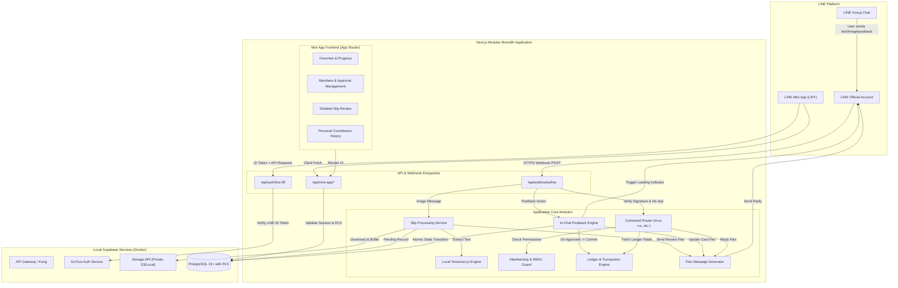
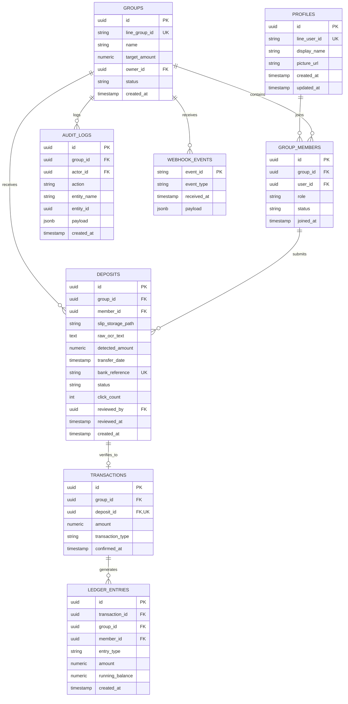
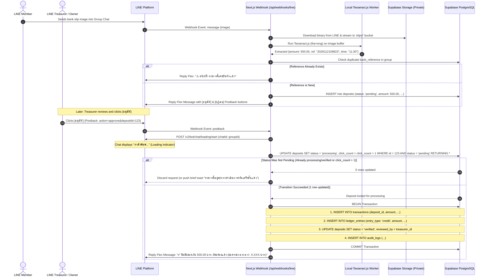

# Money Pool (Bank Buddy) — Phase 1 MVP Technical Design Document

* **Author:** NB-Psave / Bank Buddy Team
* **Status:** Completed & Unified into v.beta
* **Date:** 2026-11-22
* **Architecture Style:** Modular Monolith (Next.js + TypeScript + Local Supabase via Docker)

---

## 1. Overview

Money Pool (Bank Buddy) is a financial management system designed for friend groups, travel clubs, and shared social circles. It utilizes the LINE Group Chat as the primary user communication channel and the LINE Mini App (LIFF) as the secure member dashboard and administrative portal. 

Phase 1 MVP focuses on establishing a rock-solid, secure foundation where members register via LINE Mini App, submit money transfer slips directly in the LINE Group Chat, have their slips read via local OCR, and allow the group Owner or Treasurer to verify and approve deposits directly in the chat or through the dashboard. Financial totals are calculated strictly via an append-only, transaction-backed accounting ledger stored in a local Dockerized Supabase instance.

---

## 2. The Problem

Managing pooled funds in LINE group chats currently suffers from major operational and trust issues:
1. **Unverifiable and Cluttered Slip Tracking:** Slips posted in group chats get buried in general conversation. Members lose track of who has deposited, how much has been contributed, and what remains toward the group goal.
2. **Double-Counting and Fake Slips:** Without systematic reference checks, identical slips can be posted multiple times or reused unnoticed, distorting financial balances.
3. **Manual Bookkeeping Burden:** The group organizer (Owner/Treasurer) must manually record payments into spreadsheets or personal notes, resulting in human error and lack of transparency.
4. **Data Isolation and Security Vulnerabilities:** Ad-hoc bot scripts often fail to isolate data between groups, risk leaking personal bank details into group chats, or update financial balances directly without an audit trail.

**Proposed Solution:**
A unified Next.js modular monolith integrated with LINE Messaging API and Supabase (PostgreSQL + RLS + Auth + Storage). Slips sent to the LINE group are securely downloaded into private storage, scanned via local OCR (Tesseract.js) to extract metadata (amount, date/time, reference ID), checked for duplication, and presented with an interactive approval card in the group chat. Organizers can approve with a single tap, triggering a real-time LINE loading animation and an atomic database transaction that writes an immutable ledger entry.

---

## 3. Goals

* **G1 (Strict Group Isolation & RBAC):** Guarantee absolute data separation by `group_id` with Supabase Row-Level Security (RLS) and Role-Based Access Control (Owner, Treasurer, Member, Viewer).
* **G2 (Strict Onboarding):** Require members to onboard via LINE Mini App (LIFF) and receive Owner/Treasurer approval before their deposits and slips are accepted by the bot.
* **G3 (Local Slip OCR & Extraction):** Automatically extract amount, date/time, and transaction reference from bank slips using an embedded, local Tesseract.js engine with regex extraction, avoiding third-party OCR API dependencies in Phase 1.
* **G4 (Deterministic, Real-time In-Chat Approvals):** Enable Owner/Treasurer to approve/reject slips directly in the LINE group via Postback actions, protected by:
  - Immediate LINE typing/loading indicator (`POST /v2/bot/chat/loading/start`).
  - Atomic state transitions (`pending` $\rightarrow$ `processing` $\rightarrow$ `verified`/`rejected`).
  - Strict idempotency and rate limiting (preventing double clicks and concurrent approvals).
* **G5 (Immutable Financial Ledger):** Enforce that no financial balance can be updated by direct `UPDATE` on summary tables. All balances are derived from atomic, append-only `ledger_entries` linked to verified `transactions`.
* **G6 (Deterministic Chat Querying):** Provide instant, deterministic query responses for common commands (`#ยอดรวม`, `#ยอดฉัน`, `#ช่วยเหลือ`) via preformatted Flex Messages with sub-second response times and zero LLM hallucination risk.
* **G7 (Local Containerized Environment):** Deliver a self-contained local development setup via Docker for Supabase (Postgres, Storage, Auth, Studio) to enable zero-cost local development and testing.

---

## 4. Non-Goals

* **NG1 (Automated Bank Verification):** Direct bank API integration or Open Banking / NDID verification to confirm funds arrived in a real commercial bank account is out of scope for Phase 1 (reserved for Phase 2). OCR reads the slip image as an intake aid only.
* **NG2 (Freeform Conversational LLM in Group Chat):** Open-ended conversational LLM chatting and complex multi-turn query synthesis will not run in the group chat in Phase 1 to prevent latency, external API costs, and hallucination risks.
* **NG3 (Withdrawal Workflows & Multi-Party Sign-Off):** Money withdrawals, payouts, multi-signature approvals, and partial refunds are explicitly deferred to Phase 3.
* **NG4 (Multi-Campaign Pools in One Group):** Phase 1 enforces a Single Active Pool per LINE Group to preserve conversational clarity and database simplicity.

---

## 5. Open Questions & Technical Unknowns

* **Q1 (Tesseract Thai Font Accuracy):** Will standard Tesseract `tha+eng` language packs sufficiently recognize stylized fonts across all major Thai banks (KBank, SCB, KTB, BBL, PromptPay)? Mitigation: Fallback regex heuristics and a manual correction interface in the LIFF review dashboard.
* **Q2 (Public Webhook Ingestion during Local Dev):** A secure tunneling mechanism (such as Cloudflare Tunnel or ngrok) is required for LINE servers to reach the local Next.js Route Handler (`/api/webhooks/line`).

---

## 6. Critical User Journeys (CUJs)

### CUJ 1: Group Creation & Member Onboarding
* **Given:** A LINE Group with multiple members, and a LINE Official Account (OA) invited into the group.
* **When:** The bot receives the `join` event, it initializes the group record in Supabase and replies with a welcome Flex Message containing a LIFF registration button.
* **Then:** Members click the button to open the LINE Mini App, authenticating via LIFF. Their profile is registered as `pending_approval`. The Owner approves their membership in the Mini App, promoting them to active `Member`.

### CUJ 2: Slip Submission & Automated OCR Intake
* **Given:** An active, approved member transfers funds to the pool's designated bank account and posts the transfer slip image into the LINE group.
* **When:** LINE Webhook delivers the image event. The backend verifies the signature, streams the image into private Supabase Storage, and launches local Tesseract.js OCR.
* **Then:** The system extracts the amount, transfer timestamp, and bank transaction reference. It verifies that the reference number has not been used before, creates a `deposits` record in `pending` status, and sends a Flex Message card to the group with `[อนุมัติ]` and `[ปฏิเสธ]` Postback buttons.

### CUJ 3: Fast In-Chat Slip Approval with Loading Animation & Idempotency
* **Given:** A pending slip notification Flex Message in the group chat.
* **When:** The group Treasurer or Owner taps `[อนุมัติ]`.
* **Then:** 
  1. Server immediately dispatches a LINE Loading Animation (`POST /v2/bot/chat/loading/start`) to acknowledge the click.
  2. Server attempts an atomic database transition (`UPDATE deposits SET status = 'processing' WHERE id = :id AND status = 'pending'`).
  3. If the transition succeeds, the server creates a `transactions` record and a corresponding `ledger_entries` credit row, updates deposit to `verified`, and replies with an updated confirmation Flex Message.
  4. If another member clicks, or the treasurer clicks repeatedly, the atomic condition fails, and the second request is immediately discarded without double-crediting.

### CUJ 4: Group Balance Inquiry via Deterministic Command
* **Given:** An active member wants to check the current fund status.
* **When:** The member sends `#ยอดรวม` in the LINE group chat.
* **Then:** The bot parses the command, queries the ledger sum for the group, and immediately replies with a styled Flex Message displaying the total pool balance, total verified deposits, and progress toward the target goal.

---

## 7. Technical Plan (Architecture)

### 7.1 High-Level Architecture Diagram

### 7.2 Database Schema Specification

All tables reside in PostgreSQL with Row Level Security (RLS) enabled.

#### Detailed Table Definitions & Invariants

1. **`profiles`**:
   - `id`: UUID (Primary Key, matches `auth.users.id`).
   - `line_user_id`: VARCHAR(64) UNIQUE NOT NULL.
   - `display_name`: TEXT NOT NULL.
   - `picture_url`: TEXT.

2. **`groups`**:
   - `id`: UUID PRIMARY KEY DEFAULT gen_random_uuid().
   - `line_group_id`: VARCHAR(64) UNIQUE NOT NULL (Indexed).
   - `name`: TEXT NOT NULL.
   - `target_amount`: NUMERIC(12,2) DEFAULT 0.00.
   - `owner_id`: UUID REFERENCES profiles(id).
   - `status`: VARCHAR(20) DEFAULT 'active'.

3. **`group_members`**:
   - `id`: UUID PRIMARY KEY DEFAULT gen_random_uuid().
   - `group_id`: UUID REFERENCES groups(id) ON DELETE CASCADE.
   - `user_id`: UUID REFERENCES profiles(id) ON DELETE CASCADE.
   - `role`: VARCHAR(20) NOT NULL CHECK (role IN ('owner', 'treasurer', 'member', 'viewer')).
   - `status`: VARCHAR(20) NOT NULL CHECK (status IN ('pending_approval', 'active', 'suspended')).
   - UNIQUE (group_id, user_id).

4. **`deposits`**:
   - `id`: UUID PRIMARY KEY DEFAULT gen_random_uuid().
   - `group_id`: UUID REFERENCES groups(id) NOT NULL.
   - `member_id`: UUID REFERENCES group_members(id) NOT NULL.
   - `slip_storage_path`: TEXT NOT NULL.
   - `raw_ocr_text`: TEXT.
   - `detected_amount`: NUMERIC(12,2).
   - `transfer_date`: TIMESTAMP WITH TIME ZONE.
   - `bank_reference`: VARCHAR(100).
   - `status`: VARCHAR(20) NOT NULL DEFAULT 'pending' CHECK (status IN ('pending', 'processing', 'verified', 'rejected', 'cancelled')).
   - `click_count`: INT DEFAULT 0.
   - `reviewed_by`: UUID REFERENCES profiles(id).
   - `reviewed_at`: TIMESTAMP WITH TIME ZONE.
   - `created_at`: TIMESTAMP WITH TIME ZONE DEFAULT NOW().

5. **`transactions`**:
   - `id`: UUID PRIMARY KEY DEFAULT gen_random_uuid().
   - `group_id`: UUID REFERENCES groups(id) NOT NULL.
   - `deposit_id`: UUID UNIQUE REFERENCES deposits(id) NOT NULL.
   - `amount`: NUMERIC(12,2) NOT NULL CHECK (amount > 0).
   - `transaction_type`: VARCHAR(20) DEFAULT 'deposit'.
   - `confirmed_at`: TIMESTAMP WITH TIME ZONE DEFAULT NOW().

6. **`ledger_entries`**:
   - `id`: UUID PRIMARY KEY DEFAULT gen_random_uuid().
   - `transaction_id`: UUID REFERENCES transactions(id) NOT NULL.
   - `group_id`: UUID REFERENCES groups(id) NOT NULL.
   - `member_id`: UUID REFERENCES group_members(id) NOT NULL.
   - `entry_type`: VARCHAR(10) NOT NULL CHECK (entry_type IN ('credit', 'debit')).
   - `amount`: NUMERIC(12,2) NOT NULL CHECK (amount > 0).
   - `running_balance`: NUMERIC(12,2) NOT NULL.
   - `created_at`: TIMESTAMP WITH TIME ZONE DEFAULT NOW().
   - **Invariant:** No `UPDATE` or `DELETE` allowed on `ledger_entries`.

---

### 7.3 Sequence Workflows

#### Sequence 1: Slip Intake & In-Chat Approval with Loading Animation & Idempotency

---

### 7.4 In-Chat Command Routing Specification

When a text message arrives in the LINE group, it is evaluated by `src/modules/commands`:

1. **Prefix Detection:**
   - `#ยอดรวม` / `#สรุป`:
     - Queries `SELECT COALESCE(SUM(amount), 0) FROM ledger_entries WHERE group_id = :group_id AND entry_type = 'credit'`
     - Fetches group `target_amount`
     - Computes completion percentage: `(current_sum / target_amount) * 100`
     - Replies with formatted `GroupBalanceFlexMessage`.
   - `#ยอดฉัน` / `#ยอดผม`:
     - Resolves `member_id` via `line_user_id` and `group_id`.
     - Queries total credited amount for this specific member.
     - Replies with `PersonalBalanceFlexMessage`.
   - `#ช่วยเหลือ` / `#คำสั่ง`:
     - Replies with `HelpFlexMessage` outlining supported commands and providing the link to the LINE Mini App.
2. **Non-Command Messages:**
   - If message does not start with `#` or match a command keyword, the bot silently ignores it, avoiding any intrusion into casual group conversations.

---

### 7.5 Local Docker Services Specification

The project will include a root `docker-compose.yml` orchestrating:
1. **`postgres`**: PostgreSQL 15 with pgvector/crypto extensions, mounted to `.docker/pgdata`.
2. **`supabase-auth` (GoTrue)**: Local authentication service handling JWT verification.
3. **`supabase-storage`**: MinIO/Local storage API handling private slip storage.
4. **`app` (Optional Local Container)**: Next.js application container for Docker-parity verification.

---

## 8. Alternatives Considered

### Alternative A: Provisioning Cloud-Managed Supabase Instance vs. Local Docker Containers
* **Pros of Cloud:** Instant managed infrastructure, automated backups, zero local container resource usage.
* **Cons of Cloud:** Consumes active cloud project quotas, introduces latency and network dependency during local development, and risks accidental mutation of cloud state during early prototype iterations.
* **Reason for Rejection:** `Rejected by author: Local Dockerized Supabase provides complete development isolation, reproducibility across developer machines, zero external cost, and eliminates quota consumption during Phase 1 MVP testing.`

### Alternative B: Third-Party Thai Slip Verification API (e.g. SlipOK / EasySlip) or Cloud Vision API vs. Local Tesseract.js
* **Pros of Commercial APIs:** Higher OCR precision out-of-the-box on stylized Thai banking fonts, built-in QR payload decoding, and instant validation against bank routing numbers.
* **Cons of Commercial APIs:** Incurs recurring per-transaction subscription costs, requires external merchant registration, and introduces an external API dependency.
* **Reason for Rejection:** `Rejected by author: Phase 1 prioritizes zero-cost local operations and self-containment. Local Tesseract.js combined with regex parsing extracts amount, date, and reference numbers effectively for Phase 1. Commercial bank verification APIs are explicitly deferred to Phase 2.`

### Alternative C: Freeform LLM Conversational Router with Function Calling in LINE Chat vs. Deterministic Command Router
* **Pros of Freeform LLM:** Understands arbitrary phrasing, colloquial slang, and typos effortlessly.
* **Cons of Freeform LLM:** High response latency (1.5 - 3.0s), recurring token expenses for every routine message in high-volume group chats, and potential risk of hallucinatory financial statements.
* **Reason for Rejection:** `Rejected by author: Financial inquiries require 100% deterministic precision and immediate response times. The deterministic `#` prefix router (#ยอดรวม, #ยอดฉัน) guarantees sub-second execution, zero LLM hallucination risk, and zero token expense for chat interactions.`

### Alternative D: Approval Exclusively Inside the LINE Mini App (LIFF) vs. In-Chat Postback Action Buttons
* **Pros of Mini-App-Only Approval:** Eliminates interactive buttons from public chat; provides full-screen review interface with zoomable image views.
* **Cons of Mini-App-Only Approval:** Substantially higher friction for organizers who must open a webview for every routine deposit.
* **Reason for Rejection:** `Rejected by author: In-chat Postback action buttons provide instant, one-tap approvals directly within the group chat flow. Safety is preserved through server-side RBAC validation, immediate LINE loading animations, and atomic idempotency locks to prevent duplicate approvals.`

### Alternative E: Zero-Friction Silent Auto-Registration vs. Strict Mini App Registration Gate
* **Pros of Silent Auto-Registration:** Frictionless onboarding where members are automatically registered upon posting their first message or slip.
* **Cons of Silent Auto-Registration:** Pollutes group membership with casual onlookers or spammers; allows unauthorized members to inject unreviewed slips.
* **Reason for Rejection:** `Rejected by author: Requiring explicit onboarding via the LINE Mini App ensures members explicitly accept group rules and allows the Owner/Treasurer to audit the group roster prior to accepting deposits.`

### Alternative F: Multi-Campaign Concurrent Pools per Group vs. Single Active Pool
* **Pros of Multi-Campaign:** Allows managing multiple concurrent events (e.g., trip fund and birthday gift) inside one LINE group.
* **Cons of Multi-Campaign:** Forces members to tag every slip and query with specific pool identifiers, increasing friction and room for member error.
* **Reason for Rejection:** `Rejected by author: Single active pool per LINE group satisfies 95% of friend group use cases while keeping the chat commands and database schema simple and robust for Phase 1 MVP.`

---

## 9. Non-Functional Requirements

### 9.1 Security & Data Isolation
* **Group-Level Isolation:** Every database table containing group data must carry `group_id` foreign keys indexed and protected by Supabase Row Level Security (RLS) policies.
* **Private Storage:** The `slips` storage bucket must remain completely private. Slips can only be accessed via short-lived signed URLs (TTL $\le$ 300s) generated by authenticated backend route handlers for authorized group members.
* **Role-Based Access Control (RBAC):** All administrative endpoints (approvals, role assignment, group settings) must verify that `group_members.role IN ('owner', 'treasurer')` before executing.
* **Webhook Signature Verification:** Every incoming LINE webhook request must be cryptographically validated against `X-Line-Signature` using the channel secret using HMAC-SHA256 before processing.

### 9.2 Performance & Responsiveness
* **Sub-Second Chat Acknowledgement:** LINE reply tokens expire within seconds. All webhook endpoints must respond with `200 OK` promptly. In-chat approvals must immediately trigger the LINE loading animation (`/v2/bot/chat/loading/start`) within 300ms.
* **Asynchronous Slip Processing:** Heavy Tesseract.js OCR processing runs asynchronously, buffering results and notifying the group once processing concludes.

### 9.3 Idempotency & Concurrency Safety
* **Database Atomic Locking:** Duplicate clicks on approval buttons are repelled via conditional updates (`UPDATE deposits SET status = 'processing', click_count = click_count + 1 WHERE id = :id AND status = 'pending'`).
* **Transaction Invariance:** Financial records (`transactions`, `ledger_entries`) are created strictly inside an atomic SQL transaction block. If any step fails, the entire transaction rolls back cleanly.

---

## 10. Detailed Implementation Plan

This section provides an exhaustive enumeration of all files to be created, configured, or integrated for the Phase 1 MVP.

### 10.1 Environment & Build Configuration Files

1. **`package.json`** (`Create`)
   * **Scope:** Root dependency and script manifest.
   * **Rationale:** Configures Next.js 15, React 19, TypeScript, Tailwind CSS, `@supabase/supabase-js`, `@supabase/ssr`, `tesseract.js`, `@line/bot-sdk`, `@line/liff`, `zod`, `lucide-react`, and testing libraries (`vitest`, `@testing-library/react`).
2. **`tsconfig.json`** (`Create`)
   * **Scope:** TypeScript compiler configuration.
   * **Rationale:** Enforces strict type checking (`strict: true`), path aliases (`@/*` pointing to `./src/*`), and Next.js plugin integration.
3. **`tailwind.config.ts`** & **`postcss.config.mjs`** (`Create`)
   * **Scope:** Styling framework configuration.
   * **Rationale:** Configures Tailwind CSS themes, shadcn/ui design tokens, color palettes, and typography for responsive desktop and mobile viewports.
4. **`components.json`** (`Create`)
   * **Scope:** shadcn/ui CLI configuration.
   * **Rationale:** Directs the installation of modular UI components into `src/shared/components/ui/`.
5. **`docker-compose.yml`** (`Create`)
   * **Scope:** Local container orchestration.
   * **Rationale:** Orchestrates PostgreSQL 15, GoTrue Auth, MinIO/Local Storage, and Studio to deliver a local, zero-cost Supabase environment.
6. **`.env.example`** & **`.env.local`** (`Create`)
   * **Scope:** Environment variable templates.
   * **Rationale:** Defines required keys: `LINE_CHANNEL_SECRET`, `LINE_CHANNEL_ACCESS_TOKEN`, `NEXT_PUBLIC_LIFF_ID`, `NEXT_PUBLIC_SUPABASE_URL`, `NEXT_PUBLIC_SUPABASE_ANON_KEY`, `SUPABASE_SERVICE_ROLE_KEY`, and `NODE_ENV`.
7. **`.gitignore`** (`Create`)
   * **Scope:** Version control exclusion rules.
   * **Rationale:** Excludes `node_modules`, `.next`, `.docker/pgdata`, `.env*.local`, logs, and temporary upload artifacts.
8. **`README.md`** (`Create`)
   * **Scope:** Developer onboarding and operational guide.
   * **Rationale:** Documents prerequisites, Docker start commands, environment configuration, database migration steps, and testing instructions.

---

### 10.2 Database & Supabase Migrations (`supabase/`)

9. **`supabase/config.toml`** (`Create`)
   * **Scope:** Supabase CLI and local environment configuration.
   * **Rationale:** Configures local port mappings (API: 54321, DB: 54322, Studio: 54323) and storage buckets.
10. **`supabase/migrations/00001_initial_schema.sql`** (`Create`)
    * **Scope:** Core DDL schema migration.
    * **Rationale:** Creates tables: `profiles`, `groups`, `group_members`, `deposits`, `transactions`, `ledger_entries`, `audit_logs`, and `webhook_events` with primary keys, foreign keys, and indexes.
11. **`supabase/migrations/00002_rls_policies.sql`** (`Create`)
    * **Scope:** Security policy migration.
    * **Rationale:** Enables Row Level Security (RLS) across all tables, enforcing that users can only read and write rows matching their verified group membership and assigned role.
12. **`supabase/migrations/00003_storage_buckets.sql`** (`Create`)
    * **Scope:** Storage bucket initialization.
    * **Rationale:** Configures the `slips` storage bucket as private, with access policies permitting uploads by verified group members and reads via short-lived signed URLs.
13. **`supabase/seed.sql`** (`Create`)
    * **Scope:** Local test fixtures.
    * **Rationale:** Provides seed data for an example group, an owner profile, a treasurer profile, two members, and a target goal for instant local development and testing.

---

### 10.3 Application Core Modules (`src/modules/`)

14. **`src/modules/line-webhook/signature.ts`** (`Create`)
    * **Scope:** Cryptographic verification.
    * **Rationale:** Validates the `X-Line-Signature` HTTP header using HMAC-SHA256 against `LINE_CHANNEL_SECRET` to prevent spoofed webhook requests.
15. **`src/modules/line-webhook/event-router.ts`** (`Create`)
    * **Scope:** Webhook event dispatcher.
    * **Rationale:** Deduplicates incoming `webhookEventId`s and routes events (join, text message, image slip, postback approval) to their respective module handlers.
16. **`src/modules/line-webhook/line-client.ts`** (`Create`)
    * **Scope:** LINE Messaging API client wrapper.
    * **Rationale:** Encapsulates outgoing API calls: `replyMessage`, `pushMessage`, `getGroupMemberProfile`, and `POST /v2/bot/chat/loading/start` (loading/typing indicator).
17. **`src/modules/line-webhook/flex-templates.ts`** (`Create`)
    * **Scope:** LINE Flex Message UI component catalog.
    * **Rationale:** Generates interactive Flex Messages for: Welcome/Onboarding card, Slip Pending Review card with Postback action buttons, Slip Approved confirmation card, Duplicate Slip alert, and Group Balance summary.
18. **`src/modules/ocr/tesseract-worker.ts`** (`Create`)
    * **Scope:** Local OCR worker.
    * **Rationale:** Wraps `tesseract.js` worker initialization, loading Thai and English trained data (`tha+eng`) to convert raw image buffers into text strings within the Node runtime.
19. **`src/modules/ocr/parser.ts`** (`Create`)
    * **Scope:** Regex and heuristic slip parser.
    * **Rationale:** Parses raw OCR output using specialized regex patterns to extract transaction amount (e.g. `500.00`), transfer date/time, and bank reference numbers (e.g. `20261121...`).
20. **`src/modules/deposits/service.ts`** (`Create`)
    * **Scope:** Deposit business logic.
    * **Rationale:** Handles slip image download from LINE CDN, storage upload to Supabase, OCR triggering, duplicate reference detection, and deposit record creation.
21. **`src/modules/deposits/state-machine.ts`** (`Create`)
    * **Scope:** State transition and idempotency engine.
    * **Rationale:** Enforces state rules (`pending` $\rightarrow$ `processing` $\rightarrow$ `verified` / `rejected`). Executes atomic conditional updates to lock deposits upon user click, preventing race conditions.
22. **`src/modules/ledger/service.ts`** (`Create`)
    * **Scope:** Double-entry accounting transaction execution.
    * **Rationale:** Manages atomic SQL transactions that commit `transactions` and `ledger_entries` records upon deposit approval, computing running group balances.
23. **`src/modules/ledger/balance.ts`** (`Create`)
    * **Scope:** Financial calculation utilities.
    * **Rationale:** Computes total group balance, individual member contributions, remaining balances to goal, and completion percentages.
24. **`src/modules/membership/service.ts`** (`Create`)
    * **Scope:** Group roster and membership management.
    * **Rationale:** Manages member states (`pending_approval`, `active`, `suspended`), owner approvals, and user profile sync.
25. **`src/modules/membership/rbac.ts`** (`Create`)
    * **Scope:** Role permission validation.
    * **Rationale:** Validates whether an actor has sufficient permissions (`owner`, `treasurer`) to execute review actions or access administrative data.
26. **`src/modules/commands/handler.ts`** (`Create`)
    * **Scope:** Deterministic chat command router.
    * **Rationale:** Parses group text messages for `#ยอดรวม`, `#ยอดฉัน`, and `#ช่วยเหลือ`, executing queries and returning Flex Messages.

---

### 10.4 API Route Handlers (`src/app/api/`)

27. **`src/app/api/webhooks/line/route.ts`** (`Create`)
    * **Scope:** Primary LINE webhook POST endpoint.
    * **Rationale:** Receives LINE events, validates signature, dispatches to event router, and returns immediate `200 OK`.
28. **`src/app/api/auth/line-liff/route.ts`** (`Create`)
    * **Scope:** LIFF authentication exchange endpoint.
    * **Rationale:** Verifies the LINE ID token sent by the Mini App frontend, maps or creates a `profiles` record, and issues an authenticated Supabase session.
29. **`src/app/api/groups/route.ts`** (`Create`)
    * **Scope:** Group metadata endpoint.
    * **Rationale:** Fetches group details, pool progress, and settings for authorized members.
30. **`src/app/api/members/route.ts`** (`Create`)
    * **Scope:** Membership management endpoint.
    * **Rationale:** Provides endpoints for fetching the group member roster, approving pending members (Owner only), and updating roles.
31. **`src/app/api/deposits/route.ts`** (`Create`)
    * **Scope:** Deposit queries and manual review endpoint.
    * **Rationale:** Provides filtered deposit lists (`pending`, `verified`, `rejected`) and signed URLs for slip viewing in the Mini App.

---

### 10.5 LINE Mini App (LIFF) Frontend Views (`src/app/(mini-app)/`)

32. **`src/app/(mini-app)/layout.tsx`** (`Create`)
    * **Scope:** Mini App shell layout.
    * **Rationale:** Initializes LIFF SDK (`liff.init()`), provides authentication context provider, and renders mobile navigation header/tabs.
33. **`src/app/(mini-app)/overview/page.tsx`** (`Create`)
    * **Scope:** Main pool dashboard view.
    * **Rationale:** Displays pool balance, target progress bar, total members, recent verified transactions, and quick action buttons.
34. **`src/app/(mini-app)/my-deposits/page.tsx`** (`Create`)
    * **Scope:** Personal contribution view.
    * **Rationale:** Displays the logged-in member's historical deposits, status badges, and personal contribution total.
35. **`src/app/(mini-app)/group-members/page.tsx`** (`Create`)
    * **Scope:** Group roster and approval management.
    * **Rationale:** Allows Owners to view all members, approve pending join requests, and view individual member totals.
36. **`src/app/(mini-app)/review/page.tsx`** (`Create`)
    * **Scope:** Detailed slip review dashboard.
    * **Rationale:** Displays pending slips with side-by-side slip image inspection, OCR values, manual amount adjustments, and Approve/Reject buttons.
37. **`src/app/(mini-app)/settings/page.tsx`** (`Create`)
    * **Scope:** Group configuration view.
    * **Rationale:** Allows Owners to update target amount, pool rules, and assigned treasurers.

---

### 10.6 Shared Libraries, Components & Types (`src/shared/`, `src/lib/`)

38. **`src/shared/types/database.types.ts`** (`Create`)
    * **Scope:** TypeScript database schema definitions.
    * **Rationale:** Provides strict typing for all Supabase tables, views, and stored procedures.
39. **`src/shared/types/line.types.ts`** (`Create`)
    * **Scope:** LINE event and messaging type definitions.
    * **Rationale:** Types for webhook events, postback data payloads, and Flex Message templates.
40. **`src/shared/schemas/deposit.schema.ts`** (`Create`)
    * **Scope:** Zod validation schema.
    * **Rationale:** Validates incoming deposit submission payloads, OCR parsed values, and review actions.
41. **`src/shared/schemas/member.schema.ts`** (`Create`)
    * **Scope:** Zod validation schema.
    * **Rationale:** Validates membership onboarding requests and role changes.
42. **`src/shared/components/ui/*.tsx`** (`Create`)
    * **Scope:** shadcn/ui component primitives.
    * **Rationale:** Button, Card, Dialog, Badge, Input, Table, Progress, Toast, Tabs for building the Mini App UI.
43. **`src/integrations/supabase/server.ts`** & **`client.ts`** (`Create`)
    * **Scope:** Supabase client factories.
    * **Rationale:** Implements server-side (cookie-based SSR) and client-side Supabase client initializers.
44. **`src/lib/utils.ts`** (`Create`)
    * **Scope:** General utilities.
    * **Rationale:** Classname merger (`cn`), currency formatters (THB), and date formatters.

---

### 10.7 Test Suites (`tests/`)

45. **`tests/unit/ocr-parser.test.ts`** (`Create`)
    * **Scope:** Unit test suite for OCR regex parsing.
    * **Rationale:** Tests regex extraction against simulated raw text from major Thai banks (KBank, SCB, KTB, BBL, PromptPay) for amount, date, and reference format correctness.
46. **`tests/unit/command-router.test.ts`** (`Create`)
    * **Scope:** Unit test suite for chat command handling.
    * **Rationale:** Tests prefix matching for `#ยอดรวม`, `#ยอดฉัน`, and `#ช่วยเหลือ`, verifying that casual conversation is ignored.
47. **`tests/unit/ledger-balance.test.ts`** (`Create`)
    * **Scope:** Unit test suite for accounting calculations.
    * **Rationale:** Validates running balance calculations, credit entry additions, and goal percentages.
48. **`tests/integration/deposit-approval.test.ts`** (`Create`)
    * **Scope:** Integration test suite for deposit state transitions.
    * **Rationale:** Simulates the postback approval event, asserting that loading animation is invoked, status locks to `processing`, ledger entries are committed, and duplicate clicks are rejected.
49. **`tests/security/rls-isolation.test.ts`** (`Create`)
    * **Scope:** Security test suite.
    * **Rationale:** Validates that an authenticated user belonging to Group A cannot read or write deposits, slips, or ledger entries belonging to Group B.

---

## 11. Verification & Quality Gates

To confirm complete Phase 1 MVP implementation readiness, the following gates must pass:
1. **Compilation & Types:** `npm run build` and `npm run type-check` (tsc --noEmit) pass with 0 errors.
2. **Linting & Formatting:** `npm run lint` passes with 0 warnings or errors.
3. **Unit Tests:** `npm run test:unit` passes 100% of parser, command, and ledger tests.
4. **Integration & Concurrency Tests:** `npm run test:integration` proves that concurrent approval postback requests cannot double-credit a deposit.
5. **Security Isolation:** RLS policies pass cross-group penetration tests.

---

*Drafted with EGM*
